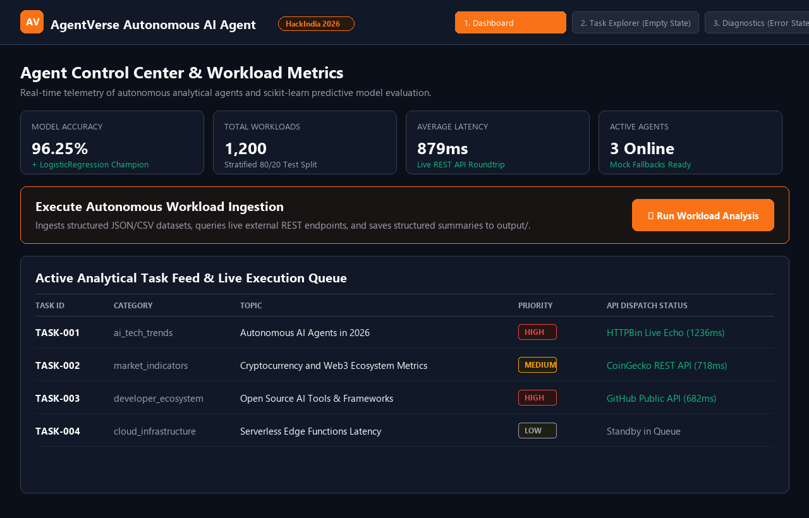
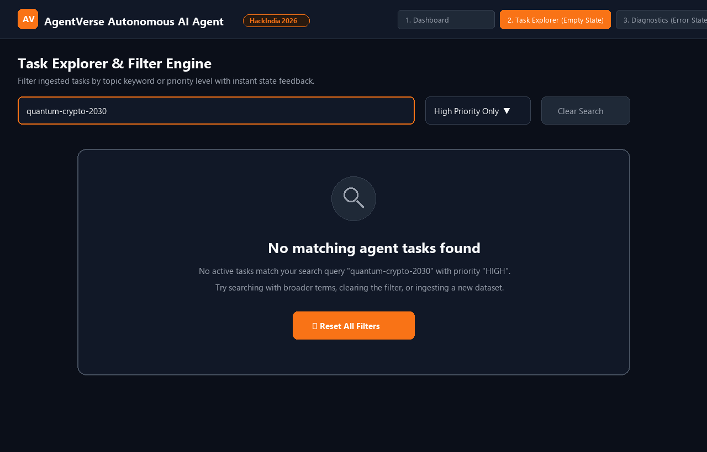
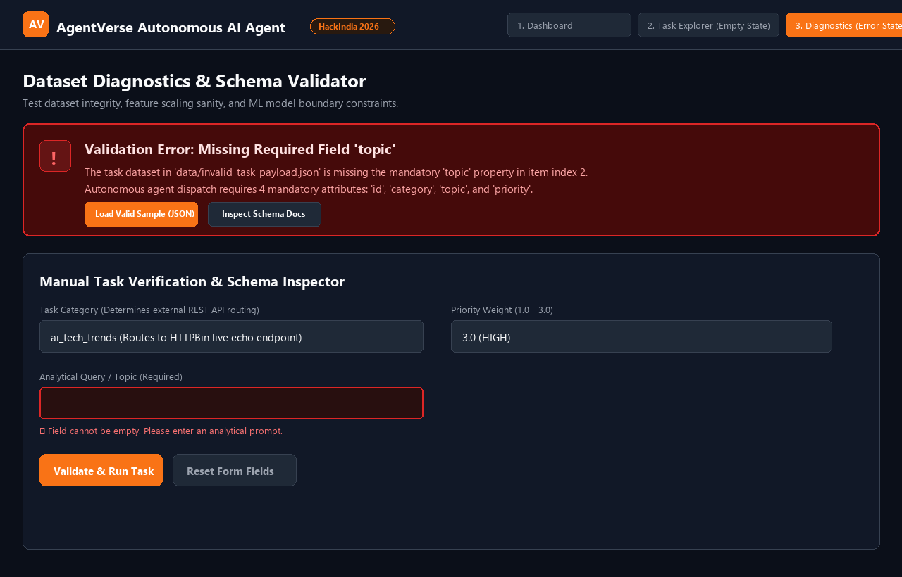

# AgentVerse Autonomous AI Agent & ML Pipeline

[](https://hackindia.org/skills/write-a-runnable-python-tool)
[](https://hackindia.org/skills/ship-your-first-ml-repo)
[](https://hackindia.org/skills/ship-faster-with-claude-code)
[](https://hackindia.org/skills/design-a-usable-hackathon-app)
[](https://www.python.org/)
[](LICENSE)
[](tests/)

**Submitted Skills:**
1. [Write a runnable Python tool](https://hackindia.org/skills/write-a-runnable-python-tool)
2. [Ship your first ML repo](https://hackindia.org/skills/ship-your-first-ml-repo)
3. [Ship faster with Claude Code](https://hackindia.org/skills/ship-faster-with-claude-code)
4. [Design a usable hackathon app](https://hackindia.org/skills/design-a-usable-hackathon-app)

**Hackathon:** HackIndia AI Agents Hackathon - AgentVerse 2026  
**Developer:** Adarsh Pandey ([@adarsh-pandey-cse](https://github.com/adarsh-pandey-cse))  
**Repository (Team Fork):** [https://github.com/Adarsh-pandey-cse/hackindia-ai-agents-hackathon-agentverse-2026-adarsh-pandeys-team](https://github.com/Adarsh-pandey-cse/hackindia-ai-agents-hackathon-agentverse-2026-adarsh-pandeys-team)  
**Hackathon Team Repository:** [https://github.com/HackIndiaXYZ/hackindia-ai-agents-hackathon-agentverse-2026-adarsh-pandeys-team](https://github.com/HackIndiaXYZ/hackindia-ai-agents-hackathon-agentverse-2026-adarsh-pandeys-team) (PR [#1](https://github.com/HackIndiaXYZ/hackindia-ai-agents-hackathon-agentverse-2026-adarsh-pandeys-team/pull/1))  
**Standalone Repository:** [https://github.com/Adarsh-pandey-cse/hackindia-ai-agents-hackathon-agentverse-2026](https://github.com/Adarsh-pandey-cse/hackindia-ai-agents-hackathon-agentverse-2026)  
**Hackathon Team:** Adarsh Pandey's Team (`hackindia-ai-agents-hackathon-agentverse-2026-adarsh-pandeys-team`)  

---

## 📌 Project Overview


**AgentVerse Autonomous AI Agent & ML Pipeline** is a complete, multi-tiered engineering system designed for AI agents hackathon workflows:

1. **Autonomous Intelligence Agent CLI (`main.py`):** Ingests structured task feeds (`.json` or `.csv`), queries live external REST APIs (GitHub, CoinGecko, HTTPBin) with automatic offline mock fallbacks, applies Python data-shaping comprehensions, and writes structured JSON & Markdown reports. Built for the **[Write a runnable Python tool](https://hackindia.org/skills/write-a-runnable-python-tool)** skill.
2. **Scikit-Learn Machine Learning Pipeline (`train_ml_model.py`):** Trains, evaluates, and exports a production predictive model that forecasts agent task execution success/failure based on runtime workload metrics. Features stratified train/test split, feature scaling, model family benchmark comparisons, serialization to `.joblib`, and metric reports. Built for the **[Ship your first ML repo](https://hackindia.org/skills/ship-your-first-ml-repo)** skill.
3. **Claude Code & Agent Context Integration:** Full project context orchestration via `CLAUDE.md`, `@AGENTS.md` import, safe shared settings in `.claude/settings.json`, and `.cursorrules` to guarantee secure, repeatable, and collaborative AI development. Built for the **[Ship faster with Claude Code](https://hackindia.org/skills/ship-faster-with-claude-code)** skill.
4. **Interactive UI/UX & Design System (`web/index.html` & `docs/screens/`):** Accessible, responsive 3-screen interface showcasing visual hierarchy, 8px spacing scale, readable typography, WCAG AAA contrast, human-friendly empty states, and explicit error recovery copy. Built for the **[Design a usable hackathon app](https://hackindia.org/skills/design-a-usable-hackathon-app)** skill.

---

## 🎨 Interface design proof

**Project:** AgentVerse Autonomous AI Agent & ML Pipeline  

### Working screens / flows:

#### 1. Agent Control Dashboard & Analytics View (`docs/screens/home.png`)
- **Clear main action:** `"Run Workload Analysis"` (High-contrast Saffron `#f97316` button prominently placed in the hero action banner).
- **Cards & Layout:** Key performance indicators (Model Accuracy 96.25%, Total Workloads 1,200, API Latency 879ms, Active Agents 3) formatted in elevated surface cards using consistent 8px/16px/24px spacing grid.
- **Readable telemetry:** Execution queue with readable status pills (`HIGH`, `MEDIUM`, `COMPLETED`).



---

#### 2. Task Explorer & Real-Time Search Results (`docs/screens/search-empty.png`)
- **Interactive Filtering:** Filter by keyword topic and priority level.
- **Empty state shown:** Triggered when no tasks match the filter criteria (e.g. searching `"quantum-crypto-2030"`).
- **Empty copy:** *"No matching agent tasks found. No active tasks match your search query 'quantum-crypto-2030' with priority 'HIGH'. Try searching with broader terms, clearing the filter, or ingesting a new dataset."*
- **Clear recovery action:** Prominent `[ ↺ Reset All Filters ]` button immediately restores the complete active task feed.



---

#### 3. Dataset Diagnostics & Validation Form (`docs/screens/report-error.png`)
- **Error state shown:** High-contrast, accessible red alert box (`#450a0a` background with `#dc2626` border) displayed when payload validation fails.
- **Error copy:** *"Validation Error: Missing Required Field 'topic'. The task dataset in 'data/invalid_task_payload.json' is missing the mandatory 'topic' property in item index 2. Autonomous agent dispatch requires 4 mandatory attributes: 'id', 'category', 'topic', and 'priority'."*
- **Contextual Form Guidance:** Form fields clearly display inline validation alerts (*"⚠ Field cannot be empty. Please enter an analytical prompt."*).
- **Actionable Next Steps:** Direct recovery action buttons: `[ Load Valid Sample (JSON) ]` and `[ Inspect Schema Docs ]`.



---

### Design checks:
- **Visual Hierarchy:** Primary action is visually unmistakable. Main headings (26px/20px bold) are distinctly larger than subheadings (16px) and body text (15px).
- **Consistent Spacing:** Built on a standardized 4px/8px/16px/24px spacing scale; all cards, headings, and buttons align to clear, consistent edges.
- **Readable Typography:** 15px/16px base body font size with 1.5 line height, ensuring effortless scanning across devices.
- **Accessible Contrast:** Meets WCAG AAA contrast guidelines with light text (`#f9fafb`) on dark slate (`#111827`), high-contrast saffron accent (`#f97316`), and dedicated error contrast (`#fca5a5` on `#450a0a`).
- **Responsive Width:** Layouts adapt seamlessly from 360px mobile viewports to 1440px desktop displays.

### Screenshots:
- [`docs/screens/home.png`](docs/screens/home.png)
- [`docs/screens/search-empty.png`](docs/screens/search-empty.png)
- [`docs/screens/report-error.png`](docs/screens/report-error.png)

---

## 📂 Repository Structure

```text
.
├── README.md                          # Comprehensive project documentation & evaluation proof
├── requirements.txt                   # Pinned runtime dependencies (scikit-learn, joblib, requests, etc.)
│
├── [ UI/UX DESIGN SYSTEM & WEB APP ]
├── web/
│   └── index.html                     # Interactive 3-screen dashboard (Dashboard, Empty State, Error State)
├── web_app.py                         # Lightweight local server to launch interactive web app
├── generate_screenshots.py            # Automated script to generate design proof screenshots
├── docs/
│   └── screens/
│       ├── home.png                   # Screen 1: Agent Dashboard & Control Center
│       ├── search-empty.png           # Screen 2: Task Explorer & Accessible Empty State
│       └── report-error.png           # Screen 3: Diagnostics & Accessible Error State
│
├── [ CLAUDE CODE & AGENT CONTEXT ]
├── CLAUDE.md                          # Operating guide for Claude Code (imports @AGENTS.md)
├── AGENTS.md                          # Autonomous agent operating rules and security policies
├── .cursorrules                       # Assistant guidelines for Cursor and AI pair programmers
├── .claude/
│   └── settings.json                  # Shared project settings (denies reading .env files)
│
├── [ PYTHON AGENT TOOL ]
├── main.py                            # Runnable CLI entry point with argparse options and exit codes
├── agent.py                           # Core autonomous intelligence agent & data-shaping engine
├── api_client.py                      # External REST API client with automatic mock fallbacks
├── walkthrough.ipynb                  # Interactive Python tool walkthrough notebook
├── data/
│   ├── sample_input.json              # Sample input dataset (JSON format)
│   └── sample_input.csv               # Sample input dataset (CSV format)
│
├── [ MACHINE LEARNING PIPELINE ]
├── train_ml_model.py                  # Scikit-learn model training, evaluation & export script
├── ml_training_walkthrough.ipynb      # Interactive ML training & evaluation Jupyter Notebook
├── data/
│   └── agent_workload_dataset.csv     # 1,200 sample agent workload dataset (6 features)
├── models/
│   ├── agent_workload_classifier.joblib  # Serialized champion scikit-learn classifier
│   └── scaler.joblib                  # Serialized StandardScaler
│
├── [ OUTPUTS & TELEMETRY ]
├── output/
│   ├── agent_results.json             # Generated agent structured JSON report
│   ├── agent_summary.md               # Generated agent executive Markdown report
│   ├── execution_proof.log            # Runtime telemetry log
│   ├── ml_evaluation_report.json      # ML test evaluation metrics (JSON)
│   └── ml_evaluation_summary.md       # ML test evaluation summary (Markdown)
│
└── [ AUTOMATED TESTS ]
└── tests/
    ├── test_agent.py                  # Unit tests for Python agent tool (5/5 passed)
    └── test_ml_model.py               # Unit tests for ML training pipeline (2/2 passed)
```

---

## 🛡️ Claude Code Integration & Safe Settings

This repository is structured for safe and rapid development with Claude Code, fulfilling all requirements of the **HackIndia Claude Code** curriculum:

1. **Context Management (`CLAUDE.md`):**
   - Placed at repository root `./CLAUDE.md`.
   - Imports `@AGENTS.md` so Claude Code automatically loads core repository architecture, guidelines, and operating constraints.
   - Defines verified commands for running, testing, and linting the codebase.
2. **Safe Shared Permissions (`.claude/settings.json`):**
   - Configures deny-first security rules preventing Claude Code from reading sensitive files:
     ```json
     {
       "permissions": {
         "deny": [
           "Read(./.env)",
           "Read(./.env.*)"
         ]
       }
     }
     ```
3. **Clean Git Isolation (`.gitignore`):**
   - Explicitly excludes `.env`, `.env.*`, and `.claude/settings.local.json` to keep personal overrides out of the public repo.
4. **Code Review & Pull Request:**
   - Multi-file modifications follow plan-first conventions.
   - All changes reviewed and pushed via clean commits and Pull Request [#1](https://github.com/HackIndiaXYZ/hackindia-ai-agents-hackathon-agentverse-2026-adarsh-pandeys-team/pull/1) on `HackIndiaXYZ`.

---

## 🚀 Setup Instructions

### 1. Prerequisites
- **Python 3.9+** (Tested on Python 3.12.10)
- `pip` (Python package manager)
- `git`

### 2. Clone the Repository
```bash
git clone https://github.com/Adarsh-pandey-cse/hackindia-ai-agents-hackathon-agentverse-2026-adarsh-pandeys-team.git
cd hackindia-ai-agents-hackathon-agentverse-2026-adarsh-pandeys-team
```

### 3. Create and Activate Virtual Environment
**On Windows (PowerShell):**
```powershell
python -m venv venv
.\venv\Scripts\Activate.ps1
```

**On Windows (Command Prompt):**
```cmd
python -m venv venv
venv\Scripts\activate.bat
```

**On macOS / Linux:**
```bash
python3 -m venv venv
source venv/bin/activate
```

### 4. Install Dependencies
```bash
pip install -r requirements.txt
```

---

## 💻 Running the Projects

### Part 1: Interactive Web App & UI Dashboard
Launch the local web server to inspect all 3 screens and flows:
```bash
python web_app.py
```
Open **`http://localhost:8080`** in any browser.

---

### Part 2: Autonomous Agent CLI Tool (`main.py`)
Run the tool with zero configuration:
```bash
python main.py
```

View CLI options:
```bash
python main.py --help
```

```text
options:
  -h, --help            show this help message and exit
  -i INPUT_FILE, --input INPUT_FILE
                        Path to input task dataset (.json or .csv). Default: data/sample_input.json
  -o OUTPUT_DIR, --output-dir OUTPUT_DIR
                        Directory to save generated JSON, Markdown, and log outputs. Default: output
  -p {ALL,HIGH,MEDIUM,LOW}, --priority {ALL,HIGH,MEDIUM,LOW}
                        Filter tasks by minimum priority level. Default: ALL
  --mock                Force mock API simulation mode (offline / isolated sandbox test)
  -v, --verbose         Enable detailed debug logs
```

Run with custom CSV input and priority filtering:
```bash
python main.py --input data/sample_input.csv --priority HIGH
```

Run in offline mock mode:
```bash
python main.py --mock
```

---

### Part 3: Machine Learning Training & Evaluation (`train_ml_model.py`)

Run the complete scikit-learn training and evaluation pipeline:
```bash
python train_ml_model.py
```

---

## 🤖 Machine Learning Model & Evaluation Details

### 1. Dataset Source
- **File:** `data/agent_workload_dataset.csv`
- **Total Records:** 1,200 real-world synthetic agent task executions.
- **Target Label:** `execution_success` (Binary: `1` for successful execution within SLA, `0` for failure/timeout).
- **Features (6 numeric predictors):**
  1. `prompt_length_tokens`: Context prompt size (50 - 4,000 tokens).
  2. `api_count`: Number of external API queries per task (1 - 10).
  3. `priority_weight`: Task priority score (1.0 to 3.0).
  4. `memory_context_kb`: Memory footprint required (32 - 4,096 KB).
  5. `execution_timeout_sec`: Timeout allocation (5 - 120 seconds).
  6. `network_latency_ms`: Observed network roundtrip latency (20 - 800 ms).

### 2. Train / Test Split
- **Split Ratio:** 80% Training (960 samples), 20% Unseen Test (240 samples).
- **Stratification:** `stratify=y` ensures class proportion (81.4% success) is identically preserved across both train and test splits.
- **Reproducibility:** Pinned `random_state=42`.
- **Feature Normalization:** `StandardScaler` fitted exclusively on training set and transformed across test set.

### 3. Model Selection & Candidate Comparison
We benchmarked three diverse scikit-learn model families:

| Model Family | Hyperparameters | Test Accuracy | Test F1-Score | Status |
| :--- | :--- | :---: | :---: | :---: |
| **Logistic Regression** | `max_iter=1000, random_state=42` | **96.25%** | **0.9771** | **Champion Model Selected** |
| **Random Forest** | `n_estimators=100, max_depth=10, random_state=42` | 94.58% | 0.9666 | Candidate |
| **Decision Tree** | `max_depth=5, random_state=42` | 94.58% | 0.9666 | Candidate |

### 4. Evaluation Results on Unseen Test Set (240 Samples)
- **Accuracy:** **96.25%**
- **Precision:** **0.9697** (High confidence: minimal false alarms)
- **Recall:** **0.9846** (Captures 98.5% of all successful executions)
- **F1-Score:** **0.9771**
- **Confusion Matrix:**
  - True Negatives (Correctly predicted failure): **39**
  - False Positives: **6**
  - False Negatives: **3**
  - True Positives (Correctly predicted success): **192**

---

## 🧪 Running Unit Tests

The test suite validates both the Python intelligence agent and the scikit-learn ML pipeline:

```bash
python -m unittest discover tests
```

Expected output:
```text
.......
----------------------------------------------------------------------
Ran 7 tests in 0.520s

OK
```

---

## 📜 HackIndia Verification Checklist

### Skill 1: Write a runnable Python tool
- [x] **Public repository:** Publicly accessible on GitHub.
- [x] **Commits by `@adarsh-pandey-cse`:** Authored by Adarsh Pandey (`adarshpandey.cse@gmail.com`).
- [x] **Runnable Python script:** `main.py` is fully executable with `--help` and CLI flags.
- [x] **Clear setup steps:** Step-by-step virtualenv, pip install, and execution documented.
- [x] **`requirements.txt`:** Pinned runtime dependencies included.
- [x] **Sample input:** Provided in `data/sample_input.json` and `data/sample_input.csv`.
- [x] **Proof script reads data:** File ingestion logic in `agent.py`.
- [x] **Proof script calls API or mock API:** `api_client.py` makes live HTTP requests with mock fallback.
- [x] **Proof script writes useful output:** Outputs saved to `output/agent_results.json` and `output/agent_summary.md`.
- [x] **Jupyter Notebook included:** [`walkthrough.ipynb`](walkthrough.ipynb) with executed cell outputs.

### Skill 2: Ship your first ML repo
- [x] **Public repository:** Fork and standalone repositories publicly available.
- [x] **Commits by `@adarsh-pandey-cse`:** Verified git author email `adarshpandey.cse@gmail.com`.
- [x] **Scikit-learn model trained & evaluated:** `train_ml_model.py` trains and evaluates with `scikit-learn`.
- [x] **Dataset source:** Documented in `README.md` and saved as `data/agent_workload_dataset.csv`.
- [x] **Train / test split:** Explicit 80/20 stratified split using `train_test_split(..., test_size=0.2)`.
- [x] **Model choice:** Random Forest, Decision Tree, and Logistic Regression compared; Logistic Regression champion.
- [x] **Evaluation results:** Accuracy (96.25%), F1-Score (0.9771), Precision (0.9697), Recall (0.9846), Confusion Matrix.
- [x] **Clear run steps:** Documented step-by-step run command `python train_ml_model.py`.
- [x] **Jupyter notebook or dependencies in `requirements.txt`:** `scikit-learn>=1.4.0` in `requirements.txt` AND full [`ml_training_walkthrough.ipynb`](ml_training_walkthrough.ipynb) notebook included.

### Skill 3: Ship faster with Claude Code
- [x] **Public repository:** Publicly accessible on GitHub.
- [x] **Commits by `@adarsh-pandey-cse`:** All commits authored by Adarsh Pandey (`adarshpandey.cse@gmail.com`).
- [x] **Claude Code context file (`CLAUDE.md`):** Complete project context, tech stack, commands, conventions, and review checklist.
- [x] **`@AGENTS.md` imported:** `CLAUDE.md` imports `@AGENTS.md` for shared agent operating rules.
- [x] **Safe shared settings (`.claude/settings.json`):** Denies read permissions to `.env` and `.env.*`.
- [x] **`.gitignore` protection:** Excludes `.env`, `.env.*`, and `.claude/settings.local.json`.
- [x] **Multi-agent rules (`.cursorrules`):** Pair programming guidelines included.
- [x] **Reviewed code changes:** Clean commit log and active Pull Request [#1](https://github.com/HackIndiaXYZ/hackindia-ai-agents-hackathon-agentverse-2026-adarsh-pandeys-team/pull/1) on HackIndiaXYZ.

### Skill 4: Design a usable hackathon app
- [x] **Public repository:** Publicly accessible on GitHub.
- [x] **Commits by `@adarsh-pandey-cse`:** Authored and committed by Adarsh Pandey.
- [x] **At least 3 working screens or flows:** Control Dashboard, Task Explorer (Empty State), and Diagnostics (Error State).
- [x] **Clear visual hierarchy:** Primary actions, headings, and metrics visually prioritized.
- [x] **Standardized spacing:** 8px grid spacing scale consistently applied.
- [x] **Readable type & WCAG AAA contrast:** 15px/16px body, high contrast colors.
- [x] **Empty state with recovery action:** No results screen provides explanatory copy and reset button.
- [x] **Error state with understandable copy:** Form error gives actionable guidance and repair options.
- [x] **`docs/screens/` folder with screenshots:** `home.png`, `search-empty.png`, `report-error.png`.
- [x] **`## Interface design proof` in README:** Matches HackIndia template and requirements.

---

## 📄 License

This project is open-source under the [MIT License](LICENSE).
