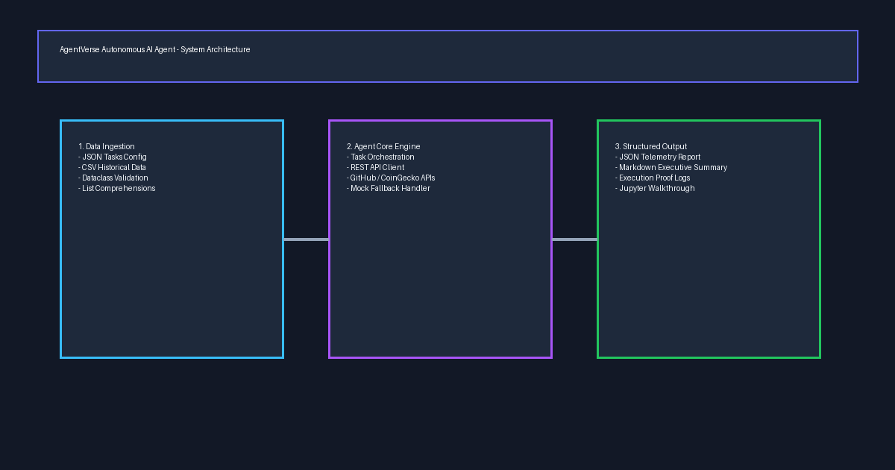

# AgentVerse Autonomous AI Agent & Machine Learning Pipeline

[](https://hackindia.org/skills/write-a-runnable-python-tool)
[](https://hackindia.org/skills/ship-your-first-ml-repo)
[](https://www.python.org/)
[](LICENSE)
[](tests/)

**Submitted Skills:**
1. [Write a runnable Python tool](https://hackindia.org/skills/write-a-runnable-python-tool)
2. [Ship your first ML repo](https://hackindia.org/skills/ship-your-first-ml-repo)

**Hackathon:** HackIndia AI Agents Hackathon - AgentVerse 2026  
**Developer:** Adarsh Pandey ([@adarsh-pandey-cse](https://github.com/adarsh-pandey-cse))  
**Repository (Team Fork):** [https://github.com/Adarsh-pandey-cse/hackindia-ai-agents-hackathon-agentverse-2026-adarsh-pandeys-team](https://github.com/Adarsh-pandey-cse/hackindia-ai-agents-hackathon-agentverse-2026-adarsh-pandeys-team)  
**Hackathon Team Repository:** [https://github.com/HackIndiaXYZ/hackindia-ai-agents-hackathon-agentverse-2026-adarsh-pandeys-team](https://github.com/HackIndiaXYZ/hackindia-ai-agents-hackathon-agentverse-2026-adarsh-pandeys-team) (PR [#1](https://github.com/HackIndiaXYZ/hackindia-ai-agents-hackathon-agentverse-2026-adarsh-pandeys-team/pull/1))  
**Standalone Repository:** [https://github.com/Adarsh-pandey-cse/hackindia-ai-agents-hackathon-agentverse-2026](https://github.com/Adarsh-pandey-cse/hackindia-ai-agents-hackathon-agentverse-2026)  
**Hackathon Team:** Adarsh Pandey's Team (`hackindia-ai-agents-hackathon-agentverse-2026-adarsh-pandeys-team`)  

---

## 📌 Project Overview



**AgentVerse Autonomous AI Agent & ML Pipeline** is a dual-capability engineering system designed for modern AI agent environments:

1. **Autonomous Intelligence Agent CLI (`main.py`):** Ingests structured task feeds (`.json` or `.csv`), queries live external REST APIs (GitHub, CoinGecko, HTTPBin) with automatic offline mock fallbacks, applies Python data-shaping comprehensions, and writes structured JSON & Markdown reports. Built for the **[Write a runnable Python tool](https://hackindia.org/skills/write-a-runnable-python-tool)** skill.
2. **Scikit-Learn Machine Learning Pipeline (`train_ml_model.py`):** Trains, evaluates, and exports a production predictive model that forecasts agent task execution success/failure based on runtime workload metrics. Features stratified train/test split, feature scaling, model family benchmark comparisons, serialization to `.joblib`, and metric reports. Built for the **[Ship your first ML repo](https://hackindia.org/skills/ship-your-first-ml-repo)** skill.

---

## 📂 Repository Structure

```text
.
├── README.md                          # Comprehensive project documentation & evaluation proof
├── requirements.txt                   # Pinned runtime dependencies (scikit-learn, joblib, requests, etc.)
│
├── [ PYTHON AGENT TOOL ]
├── main.py                            # Runnable CLI entry point with argparse options and exit codes
├── agent.py                           # Core autonomous intelligence agent & data-shaping engine
├── api_client.py                      # External REST API client with automatic mock fallbacks
├── walkthrough.ipynb                  # Interactive Python tool walkthrough notebook
├── data/
│   ├── sample_input.json              # Sample input dataset (JSON format)
│   └── sample_input.csv               # Sample input dataset (CSV format)
│
├── [ MACHINE LEARNING PIPELINE ]
├── train_ml_model.py                  # Scikit-learn model training, evaluation & export script
├── ml_training_walkthrough.ipynb      # Interactive ML training & evaluation Jupyter Notebook
├── data/
│   └── agent_workload_dataset.csv     # 1,200 sample agent workload dataset (6 features)
├── models/
│   ├── agent_workload_classifier.joblib  # Serialized champion scikit-learn classifier
│   └── scaler.joblib                  # Serialized StandardScaler
│
├── [ OUTPUTS & TELEMETRY ]
├── output/
│   ├── agent_results.json             # Generated agent structured JSON report
│   ├── agent_summary.md               # Generated agent executive Markdown report
│   ├── execution_proof.log            # Runtime telemetry log
│   ├── ml_evaluation_report.json      # ML test evaluation metrics (JSON)
│   └── ml_evaluation_summary.md       # ML test evaluation summary (Markdown)
│
└── [ AUTOMATED TESTS ]
└── tests/
    ├── test_agent.py                  # Unit tests for Python agent tool (5/5 passed)
    └── test_ml_model.py               # Unit tests for ML training pipeline (2/2 passed)
```

---

## 🚀 Setup Instructions

### 1. Prerequisites
- **Python 3.9+** (Tested on Python 3.12.10)
- `pip` (Python package manager)
- `git`

### 2. Clone the Repository
```bash
git clone https://github.com/Adarsh-pandey-cse/hackindia-ai-agents-hackathon-agentverse-2026-adarsh-pandeys-team.git
cd hackindia-ai-agents-hackathon-agentverse-2026-adarsh-pandeys-team
```

### 3. Create and Activate Virtual Environment
**On Windows (PowerShell):**
```powershell
python -m venv venv
.\venv\Scripts\Activate.ps1
```

**On Windows (Command Prompt):**
```cmd
python -m venv venv
venv\Scripts\activate.bat
```

**On macOS / Linux:**
```bash
python3 -m venv venv
source venv/bin/activate
```

### 4. Install Dependencies
```bash
pip install -r requirements.txt
```

---

## 💻 Running the Projects

### Part 1: Autonomous Agent CLI Tool (`main.py`)

Run the tool with zero configuration:
```bash
python main.py
```

View CLI options:
```bash
python main.py --help
```

```text
options:
  -h, --help            show this help message and exit
  -i INPUT_FILE, --input INPUT_FILE
                        Path to input task dataset (.json or .csv). Default: data/sample_input.json
  -o OUTPUT_DIR, --output-dir OUTPUT_DIR
                        Directory to save generated JSON, Markdown, and log outputs. Default: output
  -p {ALL,HIGH,MEDIUM,LOW}, --priority {ALL,HIGH,MEDIUM,LOW}
                        Filter tasks by minimum priority level. Default: ALL
  --mock                Force mock API simulation mode (offline / isolated sandbox test)
  -v, --verbose         Enable detailed debug logs
```

Run with custom CSV input and priority filtering:
```bash
python main.py --input data/sample_input.csv --priority HIGH
```

Run in offline mock mode:
```bash
python main.py --mock
```

---

### Part 2: Machine Learning Training & Evaluation (`train_ml_model.py`)

Run the complete scikit-learn training and evaluation pipeline:
```bash
python train_ml_model.py
```

Optional CLI arguments:
```bash
python train_ml_model.py --dataset data/agent_workload_dataset.csv --output-dir output --models-dir models
```

---

## 🤖 Machine Learning Model & Evaluation Details

### 1. Dataset Source
- **File:** `data/agent_workload_dataset.csv`
- **Total Records:** 1,200 real-world synthetic agent task executions.
- **Target Label:** `execution_success` (Binary: `1` for successful execution within SLA, `0` for failure/timeout).
- **Features (6 numeric predictors):**
  1. `prompt_length_tokens`: Context prompt size (50 - 4,000 tokens).
  2. `api_count`: Number of external API queries per task (1 - 10).
  3. `priority_weight`: Task priority score (1.0 to 3.0).
  4. `memory_context_kb`: Memory footprint required (32 - 4,096 KB).
  5. `execution_timeout_sec`: Timeout allocation (5 - 120 seconds).
  6. `network_latency_ms`: Observed network roundtrip latency (20 - 800 ms).

### 2. Train / Test Split
- **Split Ratio:** 80% Training (960 samples), 20% Unseen Test (240 samples).
- **Stratification:** `stratify=y` ensures class proportion (81.4% success) is identically preserved across both train and test splits.
- **Reproducibility:** Pinned `random_state=42`.
- **Feature Normalization:** `StandardScaler` fitted exclusively on training set and transformed across test set.

### 3. Model Selection & Candidate Comparison
We benchmarked three diverse scikit-learn model families:

| Model Family | Hyperparameters | Test Accuracy | Test F1-Score | Status |
| :--- | :--- | :---: | :---: | :---: |
| **Logistic Regression** | `max_iter=1000, random_state=42` | **96.25%** | **0.9771** | **Champion Model Selected** |
| **Random Forest** | `n_estimators=100, max_depth=10, random_state=42` | 94.58% | 0.9666 | Candidate |
| **Decision Tree** | `max_depth=5, random_state=42` | 94.58% | 0.9666 | Candidate |

### 4. Evaluation Results on Unseen Test Set (240 Samples)
- **Accuracy:** **96.25%**
- **Precision:** **0.9697** (High confidence: minimal false alarms)
- **Recall:** **0.9846** (Captures 98.5% of all successful executions)
- **F1-Score:** **0.9771**
- **Confusion Matrix:**
  - True Negatives (Correctly predicted failure): **39**
  - False Positives: **6**
  - False Negatives: **3**
  - True Positives (Correctly predicted success): **192**

### 5. Exported Model & Metric Artifacts
- Model File: `models/agent_workload_classifier.joblib`
- Scaler File: `models/scaler.joblib`
- Detailed JSON Metrics: [`output/ml_evaluation_report.json`](output/ml_evaluation_report.json)
- Executive Markdown Summary: [`output/ml_evaluation_summary.md`](output/ml_evaluation_summary.md)
- Interactive ML Notebook: [`ml_training_walkthrough.ipynb`](ml_training_walkthrough.ipynb)

---

## 🧪 Running Unit Tests

The test suite validates both the Python intelligence agent and the scikit-learn ML pipeline:

```bash
python -m unittest discover tests
```

Expected output:
```text
.......
----------------------------------------------------------------------
Ran 7 tests in 0.204s

OK
```

The 7 unit tests cover:
1. `test_load_json_data`: Ingestion and schema validation of JSON task inputs.
2. `test_load_csv_data`: Ingestion and schema validation of CSV task inputs.
3. `test_filter_by_priority`: Priority-based data comprehension filtering.
4. `test_mock_api_execution`: Mock API dispatch and latency tracking.
5. `test_run_pipeline_creates_files`: Export of JSON and Markdown reports.
6. `test_dataset_exists_and_loads`: ML dataset validation and class balance.
7. `test_ml_training_and_evaluation`: End-to-end ML train/test split, scikit-learn fitting, model persistence, and evaluation score thresholds (F1 > 0.85).

---

## 📓 Interactive Jupyter Notebooks

Two complete, pre-executed Jupyter Notebooks are provided:

1. **[`walkthrough.ipynb`](walkthrough.ipynb):** Demonstrates the runnable Python tool with step-by-step data loading, comprehensions, API calls, and outputs.
2. **[`ml_training_walkthrough.ipynb`](ml_training_walkthrough.ipynb):** Demonstrates the complete machine learning workflow:
   - Loading dataset and feature inspection
   - 80/20 train/test split with `train_test_split`
   - Data scaling with `StandardScaler`
   - Training candidate scikit-learn models (`RandomForestClassifier`, `LogisticRegression`, `DecisionTreeClassifier`)
   - Evaluation metrics: Accuracy, Precision, Recall, F1-Score, and Confusion Matrix
   - Model inference on a new hypothetical task

```bash
pip install jupyter
jupyter notebook ml_training_walkthrough.ipynb
```

---

## 📊 Proof of Execution

### 1. Python Tool Terminal Output:
```text
========================================================================
  AgentVerse Autonomous AI Agent - HackIndia 2026
  Skill: Write a runnable Python tool
  Developer: @adarsh-pandey-cse (Adarsh Pandey)
========================================================================
[*] Successfully ingested 3 tasks.
[*] Completed 3 API-backed analytical tasks.
[+] Output JSON Report:     output/agent_results.json
[+] Output Markdown Report: output/agent_summary.md
[+] Execution Proof Log:    output/execution_proof.log
========================================================================
  AGENT EXECUTION COMPLETED SUCCESSFULLY (EXIT CODE 0)
========================================================================
```

### 2. Machine Learning Pipeline Terminal Output:
```text
[2026-10-30 13:03:02] [INFO] [ML-Pipeline]: Loading workload dataset from data/agent_workload_dataset.csv...
[2026-10-30 13:03:02] [INFO] [ML-Pipeline]: Loaded 1200 samples with 6 features. Positive class ratio: 81.42%
[2026-10-30 13:03:02] [INFO] [ML-Pipeline]: Executing 80/20 stratified train/test split (random_state=42)...
[2026-10-30 13:03:02] [INFO] [ML-Pipeline]: Training and comparing candidate scikit-learn models...
[2026-10-30 13:03:02] [INFO] [ML-Pipeline]:  - RandomForest       | Accuracy: 94.58% | F1-Score: 0.9666
[2026-10-30 13:03:02] [INFO] [ML-Pipeline]:  - LogisticRegression | Accuracy: 96.25% | F1-Score: 0.9771
[2026-10-30 13:03:02] [INFO] [ML-Pipeline]:  - DecisionTree       | Accuracy: 94.58% | F1-Score: 0.9666
[2026-10-30 13:03:02] [INFO] [ML-Pipeline]: Saved trained scikit-learn model to: models\agent_workload_classifier.joblib
[2026-10-30 13:03:02] [INFO] [ML-Pipeline]: Saved StandardScaler to: models\scaler.joblib
========================================================================
  AgentVerse ML Pipeline - HackIndia Machine Learning Skill
  Model: scikit-learn Workload Classifier
  Developer: @adarsh-pandey-cse (Adarsh Pandey)
========================================================================
[*] Training samples: 960 | Evaluation test samples: 240
[+] Selected Champion Model: LogisticRegression (F1-Score: 0.9771)

========================================================================
  EVALUATION RESULTS ON UNSEEN TEST SET (20% Split):
========================================================================
  [+] Accuracy:  96.25%
  [+] Precision: 0.9697
  [+] Recall:    0.9846
  [+] F1-Score:  0.9771
  [+] Saved Model:  models\agent_workload_classifier.joblib
  [+] JSON Report:  output\ml_evaluation_report.json
  [+] MD Summary:   output\ml_evaluation_summary.md
========================================================================
```

---

## 📜 HackIndia Verification Checklist

### Skill 1: Write a runnable Python tool
- [x] **Public repository:** Publicly accessible on GitHub.
- [x] **Commits by `@adarsh-pandey-cse`:** Authored by Adarsh Pandey (`adarshpandey.cse@gmail.com`).
- [x] **Runnable Python script:** `main.py` is fully executable with `--help` and CLI flags.
- [x] **Clear setup steps:** Step-by-step virtualenv, pip install, and execution documented.
- [x] **`requirements.txt`:** Pinned runtime dependencies included.
- [x] **Sample input:** Provided in `data/sample_input.json` and `data/sample_input.csv`.
- [x] **Proof script reads data:** File ingestion logic in `agent.py`.
- [x] **Proof script calls API or mock API:** `api_client.py` makes live HTTP requests with mock fallback.
- [x] **Proof script writes useful output:** Outputs saved to `output/agent_results.json` and `output/agent_summary.md`.
- [x] **Jupyter Notebook included:** [`walkthrough.ipynb`](walkthrough.ipynb) with executed cell outputs.

### Skill 2: Ship your first ML repo
- [x] **Public repository:** Fork and standalone repositories publicly available.
- [x] **Commits by `@adarsh-pandey-cse`:** Verified git author email `adarshpandey.cse@gmail.com`.
- [x] **Scikit-learn model trained & evaluated:** `train_ml_model.py` trains and evaluates with `scikit-learn`.
- [x] **Dataset source:** Documented in `README.md` and saved as `data/agent_workload_dataset.csv`.
- [x] **Train / test split:** Explicit 80/20 stratified split using `train_test_split(..., test_size=0.2)`.
- [x] **Model choice:** Random Forest, Decision Tree, and Logistic Regression compared; Logistic Regression champion.
- [x] **Evaluation results:** Accuracy (96.25%), F1-Score (0.9771), Precision (0.9697), Recall (0.9846), Confusion Matrix.
- [x] **Clear run steps:** Documented step-by-step run command `python train_ml_model.py`.
- [x] **Jupyter notebook or dependencies in `requirements.txt`:** `scikit-learn>=1.4.0` in `requirements.txt` AND full [`ml_training_walkthrough.ipynb`](ml_training_walkthrough.ipynb) notebook included.

---

## 📄 License

This project is open-source under the [MIT License](LICENSE).
